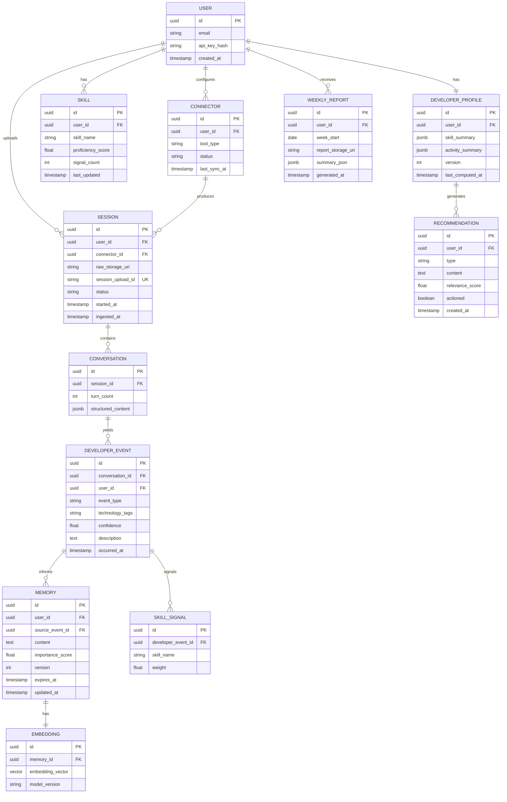

# DevMind — MVP Plan
### Scope, Data Models, API Contracts, and Project Setup (Before First Line of Code)

**Stack locked in for this plan:** FastAPI (backend), Next.js (frontend), PostgreSQL (primary DB), ChromaDB (vector DB), Redis + Celery (queue/workers), Nomic Embed Text (embeddings), Ollama for MVP / Claude+OpenAI for later (LLM), Docker Compose (local dev).

**Source of truth**: Claude Code only. No other connectors in v1.

---

## 1. Exact MVP Scope — What's In vs. Out

The biggest risk to a solo/early-stage build isn't picking the wrong tech — it's scope creep. Below is a hard line between v1 and everything else.

### 1.1 In scope for v1 (build this first)

| Feature | Why it's v1 |
|---|---|
| Claude Code, Codex, and Cursor connectors (session capture) | Three coding-agent sources needed to actually prove the "knowledge spread across AIs" thesis — a single source can't test cross-tool memory. Same capture pattern as YC's Paxel, which already does this for these three tools. |
| Raw session storage | Needed before anything else can happen |
| Session parser | Turns raw transcript into structured turns |
| Developer event extraction (LLM-assisted) | The core "understanding" step |
| Embedding generation | Required for semantic search and memory dedup |
| Memory engine (create/merge, importance, basic decay) | The core differentiator of the whole product |
| Semantic search over memories | The "have I solved this before?" feature — your headline use case |
| Skill tracking (basic incremental scoring) | Needed to produce a profile at all |
| Developer profile (read-only summary view) | The main dashboard artifact |
| Weekly report generation | Explicitly listed in your MVP feature list |
| Basic learning recommendations (rule-based, not ML-ranked) | Enough to prove the concept without over-building |
| Minimal auth (single-user or simple API key, no OAuth yet) | Don't build multi-tenant auth before you have multiple tenants |

### 1.2 Explicitly out of scope for v1 (do not build yet)

| Feature | Why it waits |
|---|---|
| GitHub connector | Requires its own GitHub App + OAuth flow + webhook server — a separate integration project, not just a new adapter |
| VS Code connector | Requires building and publishing an actual VS Code extension — separate piece of software, not a data adapter |
| Terminal connector | Technically possible via a shell hook, but touches sensitive data (typed secrets/passwords) — needs a redaction step designed before any capture code is written |
| Perplexity connector | No confirmed public API for exporting your own conversation history — verify feasibility before committing engineering time, don't assume it's buildable |
| ~~Notion AI connector~~ | **Removed from the plan entirely** — Notion's public API doesn't expose AI chat/conversation content, only page/database content, so there's no data surface to build a connector against |
| ChatGPT connector | **Not the same pattern as Claude Code/Codex/Cursor** — ChatGPT stores conversations server-side, not in local session log files. The only official retrieval path is a full-account data export (Settings → Data Controls → Export Data) which can take up to 7 days to arrive by email and isn't something a connector can trigger on a schedule. Unofficial alternatives rely on scraping the web UI or undocumented endpoints, which can break without warning. Treat this as a real, somewhat fragile integration project, closer to GitHub/Perplexity than to the other three connectors — not a quick add. |
| Gemini CLI connector | Same "coding-agent-like" pattern (local JSONL session logs at `~/.gemini/tmp/<project_hash>/chats/`), technically straightforward to add later — deferred to phase 2 purely to keep v1's connector count at three, not due to any technical blocker. Note if picked up later: Gemini CLI auto-deletes sessions after 30 days by default, so capture needs to run reasonably often once built. |
| Career Intelligence (resume parsing, job matching, ATS optimization) | Entirely separate module with its own data model (jobs, resumes) — bolt on after core loop is proven |
| Knowledge graph | Optimization on top of data you don't have enough of yet |
| Team/organization features, shared memory | Requires multi-user permissions model you haven't designed |
| LangGraph-based multi-step agent workflows | Useful later for orchestration; v1's pipeline is a fixed sequence, not a dynamic agent — don't reach for agent frameworks before the fixed pipeline works |
| Fine-grained rate limiting, autoscaling, read replicas | Operational concerns for when you have real concurrent load, not before |
| The workflow-automation platform (Gmail/Slack/Jira orchestration) | Confirmed as future scope — separate system entirely |

**Rule of thumb going forward**: if a feature requires a data source or user type you don't have in v1, it doesn't belong in v1 — regardless of how easy it looks to add "while I'm in there."

---

## 2. Data Models (Finalized for MVP)

Trimmed to only the tables v1 actually needs. Career/Job/Resume tables are intentionally excluded — they'll be a separate addition later, not retrofitted into these.

### 2.1 Entity-Relationship Diagram



### 2.2 Notes vs. the original full design

- `CONNECTOR` is back in scope for v1 (it was dropped in an earlier draft when v1 only had one source) — now that v1 has three sources, `SESSION.connector_id` is how DevMind knows *which tool* produced a given session, which matters directly for the "knowledge spread across AIs" value prop. `CONNECTOR.tool_type` should be a small constrained set for v1: `"claude_code"`, `"codex"`, `"cursor"`.
- `SKILL_SIGNAL` is a new small table not in the earlier full design — added because for MVP it's simpler and more debuggable to record each individual skill signal from an event, then compute `Skill.proficiency_score` as an aggregation job, rather than mutating the Skill row directly from multiple concurrent workers. You can collapse this into direct updates later once you trust the scoring logic.
- `AUDIT_LOG` and `PROJECT` are dropped for v1 — audit logging matters once you have real users/compliance concerns; multi-project support isn't needed when there's (initially) probably one project per user.
- `RECOMMENDATION.type` for v1 should be constrained to a small fixed set you control (e.g. `"next_technology"`, `"skill_reinforcement"`, `"documentation"`) — resist the urge to make this open-ended until the rule-based recommender is replaced with something smarter.

### 2.3 Indexes to create from day one

| Table | Index | Reason |
|---|---|---|
| `CONNECTOR` | `UNIQUE(user_id, tool_type)` | One connector row per tool per user, upsert target |
| `SESSION` | `UNIQUE(session_upload_id)` | Idempotent uploads — this is not optional, build it first |
| `SESSION` | `(connector_id, ingested_at)` | Per-tool timeline queries, and lets you compare activity across tools |
| `DEVELOPER_EVENT` | `(user_id, occurred_at)` | Timeline queries |
| `MEMORY` | `(user_id, importance_score DESC)` | Ranked retrieval for profile |
| `SKILL` | `UNIQUE(user_id, skill_name)` | Upsert target |
| `DEVELOPER_PROFILE` | `UNIQUE(user_id)` | Upsert target, one profile per user |
| `WEEKLY_REPORT` | `UNIQUE(user_id, week_start)` | Idempotent report generation |

---

## 3. API Contracts (v1)

Base path: `/api/v1`. Auth for v1: a single API key per user, sent as `Authorization: Bearer <key>` — no OAuth flow yet, that's a v2 concern.

### 3.1 `POST /sessions`

Upload a raw session from one of the connected AI coding tools.

**Request**
```json
{
  "session_upload_id": "client-generated-uuid",
  "tool_type": "claude_code",
  "started_at": "2026-07-13T10:00:00Z",
  "payload": { "turns": [ { "role": "user", "content": "..." }, { "role": "assistant", "content": "..." } ] }
}
```

`tool_type` must be one of `"claude_code"`, `"codex"`, `"cursor"` for v1 — the server looks up (or creates, on first sync) the matching `CONNECTOR` row for this user and links the new `SESSION` to it.

**Response `202 Accepted`**
```json
{ "session_id": "uuid", "status": "queued" }
```

**Errors**: `400` invalid schema · `401` invalid API key · `409` duplicate `session_upload_id` → returns the original `session_id` instead of erroring · `503` queue unavailable, safe to retry with backoff.

### 3.2 `GET /profile`

Returns the current user's profile (identified by API key — no `user_id` in the path for v1 since there's no cross-user admin access yet).

**Response `200 OK`**
```json
{
  "skills": [{ "name": "Go concurrency", "proficiency": 0.62, "signal_count": 7 }],
  "activity_summary": "...",
  "last_computed_at": "2026-07-12T09:00:00Z"
}
```

**Errors**: `401` unauthenticated · `404` profile not yet computed (first session still processing).

### 3.3 `GET /memories/search?q=...`

Semantic search over the user's own memories.

**Response `200 OK`**
```json
{
  "query": "issues with slow api calls",
  "results": [
    { "memory_id": "uuid", "content": "...", "score": 0.87, "updated_at": "..." }
  ]
}
```

**Errors**: `400` empty/too-long query · `401` unauthenticated.

### 3.4 `GET /reports/{week_start}`

**Response `200 OK`**
```json
{
  "week_start": "2026-07-06",
  "summary": "...",
  "top_memories": ["uuid"],
  "recommendations": ["uuid"],
  "report_url": "https://.../report.pdf"
}
```

**Errors**: `404` no report generated for that week yet.

### 3.5 `GET /recommendations`

**Response `200 OK`**
```json
{
  "recommendations": [
    { "id": "uuid", "type": "next_technology", "content": "...", "relevance_score": 0.8 }
  ]
}
```

### 3.6 Conventions for every endpoint

- Cursor-based pagination on all list endpoints (`?cursor=...&limit=50`) — never offset-based, even in v1, since retrofitting pagination later is painful.
- Consistent error envelope: `{ "error": { "code": "string", "message": "string", "request_id": "uuid" } }`.
- All `POST` endpoints require the client-generated idempotency key shown above — build this in from the very first endpoint, not as an afterthought.

---

## 4. Project Setup

### 4.1 Folder structure (Clean Architecture, trimmed for MVP — single deployable backend, not yet split into microservices)

```
devmind/
├── backend/
│   ├── app/
│   │   ├── domain/                # entities: Session, DeveloperEvent, Memory, Skill, Profile
│   │   ├── application/           # use cases: UploadSession, SearchMemories, GetProfile, GenerateReport
│   │   ├── infrastructure/
│   │   │   ├── db/                 # SQLAlchemy models + repositories (Postgres)
│   │   │   ├── vectorstore/        # ChromaDB client wrapper
│   │   │   ├── queue/              # Celery task definitions
│   │   │   ├── llm/                # LLMProvider interface + Ollama/Claude/OpenAI adapters
│   │   │   └── embeddings/         # EmbeddingProvider interface + Nomic adapter
│   │   ├── interfaces/
│   │   │   └── http/               # FastAPI routers + Pydantic schemas
│   │   └── main.py                # FastAPI app entrypoint
│   ├── workers/
│   │   ├── parser_worker.py
│   │   ├── event_extractor_worker.py
│   │   ├── embedding_worker.py
│   │   ├── memory_worker.py
│   │   ├── profile_worker.py
│   │   ├── recommendation_worker.py
│   │   └── report_worker.py
│   ├── tests/
│   ├── alembic/                    # DB migrations
│   ├── pyproject.toml
│   └── Dockerfile
│
├── frontend/
│   ├── app/                       # Next.js app router pages (dashboard, profile, search, reports)
│   ├── components/
│   ├── lib/                       # API client
│   └── Dockerfile
│
├── connectors/
│   ├── shared/                     # common RawSessionIngestion contract all connectors implement
│   ├── claude-code-connector/      # reads Claude Code local session logs, calls /sessions
│   ├── codex-connector/            # reads Codex CLI local session logs, calls /sessions
│   └── cursor-connector/           # reads Cursor local session logs, calls /sessions
│
├── shared/
│   └── contracts/                 # OpenAPI spec, shared type definitions
│
├── docker-compose.yml              # postgres, redis, chromadb, backend, celery worker, frontend
└── docs/
    └── architecture/               # this document + future ADRs
```

### 4.2 What `docker-compose.yml` needs to bring up locally

- `postgres` — primary DB
- `redis` — Celery broker + cache
- `chromadb` — vector store
- `backend` — FastAPI app
- `celery-worker` — one worker service consuming all queues to start (split into per-stage worker services only once you actually need independent scaling — don't over-engineer this on day one)
- `frontend` — Next.js dev server
- (optional, add when needed) `ollama` — local LLM for MVP if you're not calling a hosted API yet

### 4.3 Suggested build order (this is the actual sequence to code in)

1. `docker-compose.yml` with just Postgres + Redis running, confirm both are reachable.
2. Domain models + Alembic migration for `User` and `Session` only — get one table round-tripping before adding the rest.
3. `POST /sessions` endpoint, writing to Postgres and a local/dev object storage stand-in (even just a local folder is fine at this stage) — confirm idempotency works before moving on.
4. Wire in Celery + Redis: one trivial worker task, confirm the queue round-trips end to end.
5. Session parser worker — real logic, writes `Conversation` rows.
6. Event extractor worker — first real LLM integration point; start with Ollama locally to avoid API costs while iterating.
7. Embedding worker + ChromaDB — confirm you can store and query a vector before wiring it into the pipeline.
8. Memory worker — the merge/create logic; this is the trickiest piece, budget the most time here.
9. Skill + profile workers — mostly aggregation logic, should move faster once memory works.
10. `GET /profile` and `GET /memories/search` endpoints — first real user-facing value, a good checkpoint to demo.
11. Recommendation worker (rule-based) + report worker — last, since they depend on everything above already working.
12. Frontend dashboard, wired to the endpoints above.

This order deliberately front-loads the riskiest, least-familiar part (LLM extraction + memory merge logic) right after the plumbing is proven, rather than saving it for last — so if it turns out harder than expected, you find out early, not after building a frontend around assumptions that don't hold.

---

## Open decisions worth locking in before you start (ask yourself, or come back and we'll work through them)

- **Single-user or multi-user from day one?** The plan above assumes multi-user-capable schema (every table has `user_id`) even though v1 might only have one real user — this is cheap to build in now, expensive to retrofit later.
- **Ollama vs. hosted API for the event extractor, on day one?** Ollama avoids cost during heavy iteration but may give weaker extraction quality — worth a quick side-by-side test before committing.
- **How aggressive should memory merge similarity threshold be at first?** Start conservative (fewer merges, more distinct memories) — it's easier to notice "too many similar memories" and tighten later than to have wrongly-merged memories you can't easily un-merge.
